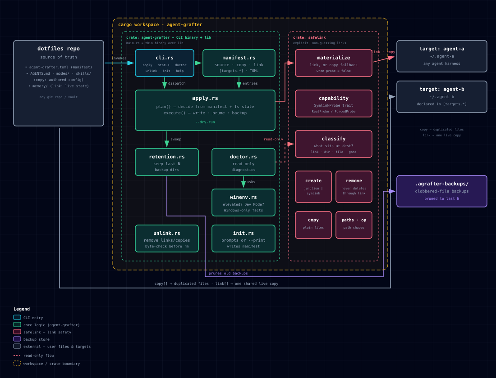

# agent-grafter

[](https://github.com/CrupanshuUdani/agent-grafter/actions/workflows/ci.yml?query=branch%3Amain) [](https://github.com/CrupanshuUdani/agent-grafter/actions/workflows/docker.yml?query=branch%3Amain) [](https://github.com/CrupanshuUdani/agent-grafter/actions/workflows/ci.yml?query=branch%3Amain) [](https://github.com/CrupanshuUdani/agent-grafter/actions/workflows/ci.yml?query=branch%3Amain) [](https://github.com/CrupanshuUdani/agent-grafter/actions/workflows/ci.yml?query=branch%3Amain) [](#building-from-source) [](LICENSE) 

**Alpha.** The manifest format may still change before 1.0. Pin a commit if
you depend on it.

## The problem

If you use an AI coding agent on more than one system (a dual-boot laptop, a
work and a home machine, or two agent tools side by side), its files drift
apart. Instructions you improved in one place never reach the other. What
the agent learned on Windows yesterday is missing when you boot into Linux
today.

The usual fix is to keep the files in one shared folder and symlink to it.
On Windows that needs administrator rights or Developer Mode, which most
people don't have switched on and many work machines don't allow.

## The fix

You write one small file listing what to share and where it should go.
agent-grafter then puts those files in place on each system. Files you
write yourself, like instructions and skills, are copied, so each system
keeps working on its own. Files the agent writes, like its memory, are
linked, so every system reads and writes the same copy. On Windows the links
are directory junctions, which any user can create.

It never deletes through a link, backs up anything it overwrites, and can
show you every change before making it. [EXAMPLES.md](EXAMPLES.md) walks
through real setups.

## How it works

agent-grafter is a CLI that materializes a declared set of AI-agent
config/state files onto one or more targets (agent harnesses, machines,
whatever paths you name), as copies or as live links, from a single TOML
manifest. It works on Windows without administrator rights or Developer
Mode.



## The name

A graft joins a scion (the part you've deliberately grown) onto a
rootstock, so both share one living connection without either being copied.
That's the `link` half of this tool: `memory/` on disk in two places is
really one file, read and written by whichever target touches it. `copy`
entries are the ordinary case: a duplicate, made and then left alone.

## Why not just symlinks?

Creating a real file or directory symlink on Windows requires either
Developer Mode or `SeCreateSymbolicLinkPrivilege`, which in practice means
running the process as administrator. Most people don't have either turned
on, and turning on Developer Mode isn't something a config-sync tool should
ask you to do. Directory junctions (`mklink /J`) need neither. Any user can
create one, and they work across local volumes. That's why `link` entries
that name a directory become a junction on Windows and a symlink on POSIX.
A `link` entry that names a single *file* has no admin-free link primitive
on Windows at all, so it falls back to a copy there unless the process
happens to be elevated or Developer Mode is on. See the platform matrix
below.

## Install

Not yet published to crates.io (alpha). Build from source:

```sh
git clone https://github.com/CrupanshuUdani/agent-grafter
cd agent-grafter
cargo install --path crates/agent-grafter
```

This puts `agent-grafter` on your `PATH`. See "Building from source" below
for the MSRV this requires.

## 60-second quickstart

`agent-grafter init` (no flags) asks a short series of questions
interactively and writes `agent-grafter.toml` for you. For a non-interactive
look at the same template, `--print` writes it to stdout instead of a file:

```
$ agent-grafter init --print
# Generated by `agent-grafter init`. Edit freely -- these comments explain
# each field. Run `agent-grafter apply --dry-run` to preview what this
# manifest would do before it touches anything.

# Where your declared entries live, relative to this file.
source = "."

# Copied into each target -- safe for entries a shared volume might not
# always be mounted, or that must not be silently shared.
copy = ["copy-me.md"]

# Linked into each target: one copy, read and written by every target.
link = ["memory/"]

# Target names are arbitrary labels you choose.
[targets."example"]
dest = "~/.example"
```

Two things the template doesn't spell out:

- `source` resolves relative to the **manifest file's own directory**, not
  wherever you happen to run the command from. `dest` resolves relative to
  the **process's current directory** instead. The two are independent, so
  a relative `dest` behaves differently depending on where you invoke
  `agent-grafter` from. Use an absolute or `~`-prefixed `dest` unless you
  always run from the same place.
- The target root must already exist. `apply` refuses to create it (a
  typo in `dest` must not silently build a tree in the wrong place), so
  create the directory yourself first.

Here's a filled-in version, with `source/copy-me.md` and `source/memory/`
already created and `example-target/` already existing as an empty
directory:

```toml
source = "source"
copy = ["copy-me.md"]
link = ["memory"]

[targets.example]
dest = "example-target"
```

Preview before touching anything:

```
$ agent-grafter apply --dry-run
example: would write: memory
example: would write: copy-me.md
```

Nothing has been written yet. Run it for real:

```
$ agent-grafter apply
example: wrote: memory
example: wrote: copy-me.md
```

And check it stays that way later:

```
$ agent-grafter status
example: in sync: memory
```

`status` checks `link` entries against the current filesystem; `doctor` (see
below) checks everything, `copy` entries included, plus your backup
directory's health.

## Commands

| Command | What it does | Writes? |
|---|---|---|
| `init` | Prompts for a manifest, or `--print`s a commented template to stdout | Only without `--print` |
| `apply` | Materializes declared `copy`/`link` entries; prunes stale copied files; sweeps old backups | Yes, unless `--dry-run` |
| `status` | Reports whether declared `link` entries are in sync | No |
| `doctor` | Wider read-only diagnostics: every `copy`/`link` entry, link-target drift, backup directory health, OS/tooling facts | No |
| `unlink` | Removes previously materialized links and copies that still match their source; refuses everything else | Yes, unless `--dry-run` |
| `help` | Clap's built-in help, including per-subcommand help | No |

There is no `explain` command: `apply --dry-run` already prints the full
plan, and `--help`/`help` cover the rest.

### Exit codes

| Code | Meaning |
|---|---|
| 0 | Success, or `status`/`doctor` found nothing to report |
| 1 | Unexpected error |
| 2 | Invalid usage, or the manifest couldn't be read/parsed |
| 3 | `status`/`doctor` found drift — a finding, not an error |
| 4 | Refused for a safety reason (occupied destination, missing source, conflicting entries, and similar) |

(`crates/agent-grafter/src/cli.rs`)

## What this tool will never do

- Never delete through a link. Removing a link (`unlink`, or `apply`
  replacing one) removes the link object itself; the thing it points at is
  never touched, because link removal never traverses the link
  (`crates/safelink/src/remove.rs`).
- Never touch real data because a source went missing. A missing
  `link`/`copy` source is refused, not treated as "delete the destination":
  *"the declared source … does not exist; nothing was written"*
  (`crates/agent-grafter/src/apply.rs`). The same asymmetry holds for
  pruning stale copies: an unreadable or absent source directory yields
  zero prune candidates, never a partial guess. Under-reading the source,
  not the destination, is the one mistake that would delete files that are
  still correctly declared.
- Never link a whole config directory. A manifest entry naming the
  entire `source` root (or escaping it, or naming a known credential
  filename like `.env` or `id_rsa` outright) is refused at parse time. You
  must declare individual files or subdirectories
  (`crates/agent-grafter/src/manifest.rs`).

`apply` backs up anything it's about to overwrite into
`.agrafter-backups/<UTC timestamp>/` under the target root, and keeps the
last 10 such directories (`crates/agent-grafter/src/retention.rs`). `unlink`
creates no backups and never touches that directory: it only ever removes
a link (which destroys nothing) or a plain file it can first prove is
byte-identical to its still-existing source, so there is nothing of the
user's to lose (`crates/agent-grafter/src/unlink.rs`).

## Platform support

| Platform | `link` (directory) | `link` (file) | `copy` | Status |
|---|---|---|---|---|
| Linux | symlink | symlink | atomic copy | CI-tested |
| macOS | symlink | symlink | atomic copy | CI-tested |
| Windows, elevated / CI runner | NTFS junction | symlink | atomic copy | CI-tested — GitHub's `windows-latest` runners run elevated with UAC disabled, and CI asserts that (`.github/workflows/ci.yml`), so junction creation, classification, and safe removal are proven on a real Windows kernel |
| Windows, standard user, Developer Mode off | NTFS junction (admin-free) | atomic copy (capability-detected fallback) | atomic copy | **Unverified by a human run.** CI cannot exercise this path — an elevated process always has `SeCreateSymbolicLinkPrivilege`, so it can't observe the standard-user `false` result. Covered today by `ForcedProbe(false)` unit tests and a manual `cargo run --example smoke` (see `crates/safelink/README.md`), not by an end-to-end run of the CLI on a real non-admin account |

A file `link` entry is downgraded to a copy whenever the runtime
capability probe (`safelink::capability::SymlinkProbe`) reports that a
symlink can't be created near the destination, never assumed either way.

## Building from source

### Requirements

Minimum Supported Rust Version (MSRV): **1.88.0**.

MSRV here is higher than the edition-2024 floor (1.85.0) because this
codebase uses if-let chains (stabilized in 1.88.0), e.g. in
`crates/agent-grafter/src/manifest.rs` and `apply.rs`. The workspace's
`rust-version = "1.88"` (root `Cargo.toml`) enforces this at `cargo check`
time, and CI runs a dedicated job pinned to exactly this toolchain so the
claim stays true.

```sh
cargo build -p agent-grafter          # debug
cargo build -p agent-grafter --release
cargo test --workspace --all-targets
```

## License

Apache-2.0. See `LICENSE` and `NOTICE`. Release binaries will ship a
generated `THIRD-PARTY-LICENSES` file covering the license obligations of
compiled-in dependencies (notably `junction`, MIT).

## More

- [`EXAMPLES.md`](EXAMPLES.md): dual-boot, two agents sharing memory, a
  locked-down work laptop, a config repo in git, and how to undo it all.
- [`FAQ.md`](FAQ.md): junctions vs. symlinks, admin rights, unmounted
  drives, Cursor/Copilot/Hermes support, and more.
- [`COMPARISON.md`](COMPARISON.md): honest comparison against `chezmoi` and
  `agentsync`.
- [`TROUBLESHOOTING.md`](TROUBLESHOOTING.md): the Windows traps this
  project has actually hit.
- [`SECURITY.md`](SECURITY.md): threat model and how to report a
  vulnerability.
- [`CONTRIBUTING.md`](CONTRIBUTING.md): running the test suite, and what
  evidence a Windows-only change needs.
- [`CHANGELOG.md`](CHANGELOG.md).
